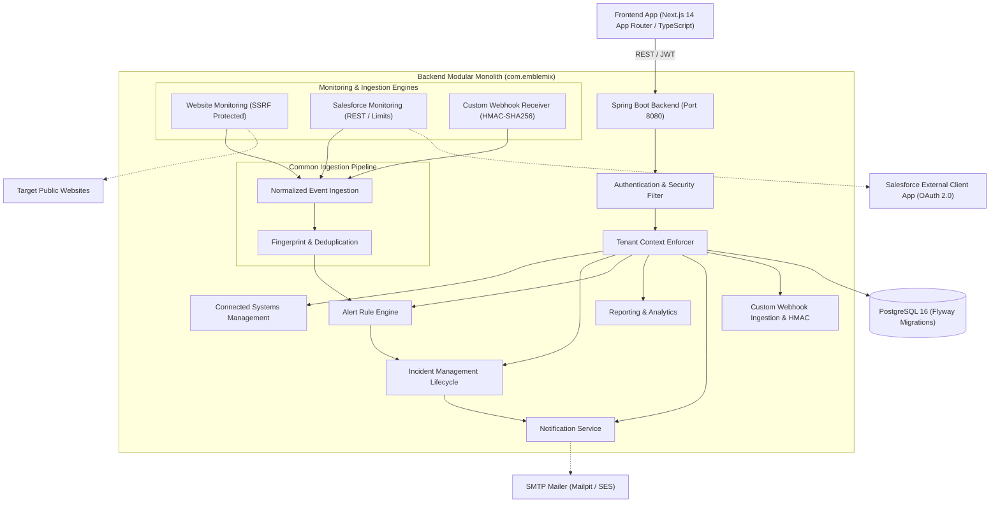
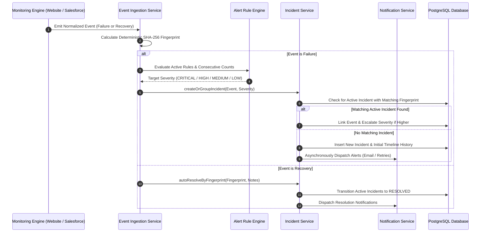

# Architecture Documentation: Emblemix Platform

Emblemix is built as a high-performance **modular monolith** adhering to clean architecture principles, strict multi-tenancy boundaries, and an event-driven incident pipeline.

---

## 1. High-Level System Architecture

---

## 2. Event-Driven Incident Lifecycle

---

## 3. Package Structure

The backend source code strictly enforces domain boundaries under `com.emblemix`:
- `auth`: JWT token authentication, refresh rotation, password recovery.
- `organization`: Tenant organization domain and workspace isolation.
- `user`: User identities, profiles, and role-based permissions (`ORG_ADMIN`, `ENGINEER`, `VIEWER`).
- `system`: Connected system catalogue and multi-environment tracking.
- `integration`: Encrypted credential persistence and connector abstractions.
- `monitoring.website`: SSRF-protected HTTP/HTTPS scheduler and SSL certificate inspector.
- `monitoring.salesforce`: OAuth 2.0 Web Server code exchange, API limits, and Async Apex Job tracking.
- `event`: Normalized event model, fingerprint generation, and ingestion pipeline.
- `alert`: Configurable threshold evaluation and rule engine.
- `incident`: Complete incident lifecycle (OPEN, ACKNOWLEDGED, RESOLVED), grouping, timeline, and comments.
- `notification`: Multi-channel asynchronous notification dispatch with exponential retries.
- `reporting`: Aggregation engine, uptime metrics, and RFC 4180 CSV exports.
- `audit`: Immutable security audit trails.
- `common`: Cross-cutting security, encryption, global exception handling, and response models.
