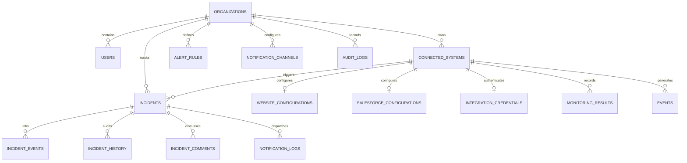

# Database Design: Emblemix Platform

Emblemix uses **PostgreSQL 16** with **Flyway** migration management for versioned schema evolution. All tenant-scoped entities enforce `organization_id` partitioning and UUID primary keys.

---

## 1. Entity-Relationship Model

---

## 2. Table Schemas Overview

### `organizations`
- `id` (UUID PK): Unique tenant organization identifier.
- `name` (VARCHAR 255): Display name of the organization.
- `slug` (VARCHAR 100 UNIQUE): Normalized slug for tenant identification.
- `created_at`, `updated_at`: Timezone-aware audit timestamps.

### `users`
- `id` (UUID PK): Unique user identifier.
- `organization_id` (UUID FK): Tenant ownership boundary.
- `email` (VARCHAR 255 UNIQUE): User login identifier.
- `password_hash` (VARCHAR 255): BCrypt salted password hash.
- `first_name`, `last_name`: User names.
- `role` (VARCHAR 50): `SUPER_ADMIN`, `ORG_ADMIN`, `ENGINEER`, `VIEWER`.
- `enabled` (BOOLEAN): Active status flag.

### `connected_systems`
- `id` (UUID PK): System identifier.
- `organization_id` (UUID FK): Tenant boundary.
- `name` (VARCHAR 255): System name.
- `system_type` (VARCHAR 50): `WEBSITE` or `SALESFORCE`.
- `environment` (VARCHAR 50): `PRODUCTION`, `STAGING`, `DEVELOPMENT`.
- `status` (VARCHAR 50): `HEALTHY`, `DEGRADED`, `DOWN`, `UNKNOWN`.
- `last_monitored_at`: Timestamp of most recent check.

### `website_configurations`
- `id` (UUID PK): Configuration ID.
- `system_id` (UUID FK UNIQUE): Reference to parent connected system.
- `url` (TEXT): Target HTTP / HTTPS endpoint.
- `monitoring_interval_seconds` (INT): Default 60s.
- `request_timeout_ms` (INT): Default 5000ms.
- `expected_http_status_min`, `expected_http_status_max`: Range (e.g. 200..299).
- `check_ssl` (BOOLEAN): Enables peer SSL certificate expiry check.
- `ssl_expiry_threshold_days` (INT): Default 30 days.
- `consecutive_failure_threshold` (INT): Default 2 failures before alert.
- `current_consecutive_failures` (INT): Current failure streak counter.

### `integration_credentials`
- `id` (UUID PK): Credential ID.
- `system_id` (UUID FK UNIQUE): Connected system reference.
- `encrypted_access_token` (TEXT): AES-256 GCM encrypted token at rest.
- `encrypted_refresh_token` (TEXT): AES-256 GCM encrypted token at rest.
- `instance_url` (VARCHAR 512): Assigned Salesforce instance endpoint.
- `external_org_id` (VARCHAR 255): External Salesforce Organization ID.

### `events`
- `id` (UUID PK): Normalized event ID.
- `system_id` (UUID FK): Originating system.
- `source_type` (VARCHAR 50): `WEBSITE`, `SALESFORCE`, `CUSTOM`.
- `event_type` (VARCHAR 100): E.g. `WEBSITE_DOWN`, `APEX_JOB_FAILED`.
- `severity` (VARCHAR 50): `LOW`, `MEDIUM`, `HIGH`, `CRITICAL`.
- `fingerprint` (VARCHAR 255): Deterministic SHA-256 deduplication key.
- `status` (VARCHAR 50): `NEW`, `PROCESSED`, `IGNORED`.

### `incidents`
- `id` (UUID PK): Incident record ID.
- `organization_id` (UUID FK): Tenant boundary.
- `system_id` (UUID FK): Associated system.
- `title` (VARCHAR 255): Incident headline.
- `severity` (VARCHAR 50): `LOW`, `MEDIUM`, `HIGH`, `CRITICAL`.
- `status` (VARCHAR 50): `OPEN`, `ACKNOWLEDGED`, `INVESTIGATING`, `RESOLVED`, `CLOSED`.
- `fingerprint` (VARCHAR 255): SHA-256 grouping fingerprint.
- `assigned_user_id` (UUID FK): Assigned engineer.
- `resolution_notes` (TEXT): Final root-cause and resolution notes.
- `acknowledged_at`, `resolved_at`: Key SLA timestamps.
