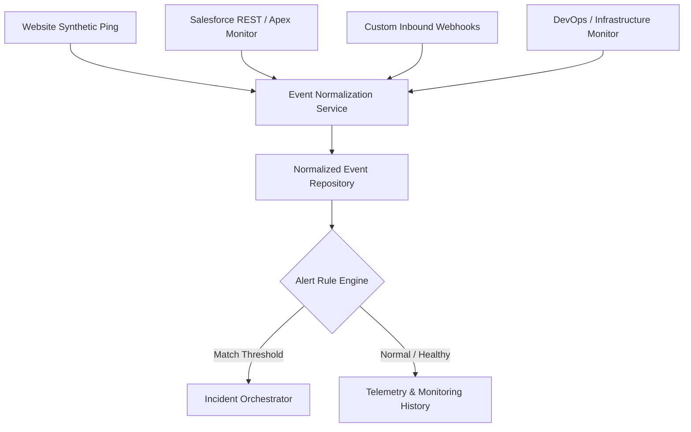

# Normalized Event Schemas & Ingestion Pipeline

## 1. Overview

Emblemix operates a **Universal Ingestion & Normalization Engine**. Regardless of origin—HTTP ping, Salesforce SOQL query, container orchestrator metric, or custom external webhook—every operational event is mapped to a canonical schema.



---

## 2. Universal Normalized Event Schema

All ingested events conform to the following JSON structure:

```json
{
  "id": "e458e0be-62eb-4043-b9dc-cf7c89eb2bc7",
  "organizationId": "098801ca-3546-4a7c-98e6-fdce13fc3726",
  "systemId": "8f24aa55-149d-4394-bb9e-117eebe397d9",
  "sourceType": "WEBSITE | SALESFORCE | WEBHOOK | API | INFRASTRUCTURE",
  "severity": "LOW | MEDIUM | HIGH | CRITICAL",
  "status": "SUCCESS | WARNING | FAILURE",
  "title": "Short descriptive event summary",
  "message": "Detailed error message or health context",
  "fingerprint": "SHA-256 fingerprint used for deduplication",
  "metadata": {
    "key": "value"
  },
  "occurredAt": "2026-11-24T12:00:00Z"
}
```

---

## 3. Discipline-Specific Event Payloads

### 3.1 Website Monitoring Event

```json
{
  "sourceType": "WEBSITE",
  "systemId": "web-prod-portal",
  "severity": "HIGH",
  "status": "FAILURE",
  "title": "Website HTTP 504 Gateway Timeout",
  "message": "Synthetic ping to https://app.example.com timed out after 5000ms",
  "fingerprint": "hash(systemId + 'WEBSITE' + '504')",
  "metadata": {
    "url": "https://app.example.com/healthz",
    "httpStatusCode": 504,
    "responseTimeMs": 5002,
    "sslValid": true,
    "sslDaysRemaining": 68
  }
}
```

---

### 3.2 Salesforce Organization Event

```json
{
  "sourceType": "SALESFORCE",
  "systemId": "sfdc-na142-prod",
  "severity": "CRITICAL",
  "status": "FAILURE",
  "title": "Salesforce API Daily Limit Exceeded",
  "message": "Daily API Requests reached 94.2% of organization quota (94,200 / 100,000)",
  "fingerprint": "hash(systemId + 'SALESFORCE' + 'API_LIMIT')",
  "metadata": {
    "instanceUrl": "https://na142.salesforce.com",
    "isSandbox": false,
    "apiUsagePct": 94.2,
    "failedApexJobsLastHour": 4,
    "failedLoginAttempts": 12
  }
}
```

---

### 3.3 DevOps & Infrastructure Event

```json
{
  "sourceType": "INFRASTRUCTURE",
  "systemId": "k8s-cluster-us-east-1",
  "severity": "CRITICAL",
  "status": "FAILURE",
  "title": "Kubernetes Node DiskPressure Triggered",
  "message": "Node ip-10-0-4-12.ec2.internal root volume utilization exceeded 92%",
  "fingerprint": "hash(systemId + 'INFRASTRUCTURE' + 'DiskPressure')",
  "metadata": {
    "cluster": "prod-useast1",
    "node": "ip-10-0-4-12.ec2.internal",
    "diskUsagePct": 92.4,
    "affectedPods": 14
  }
}
```

---

### 3.4 Custom Webhook Ingestion (Payment Gateway / External Service)

Inbound payloads sent to `POST /api/v1/webhooks/inbound/{webhookId}` with signature verification:

```json
{
  "eventType": "payment_failure_burst",
  "service": "checkout-service",
  "severity": "HIGH",
  "timestamp": 1732449600,
  "summary": "15 consecutive Stripe Webhook 500 errors detected within 60 seconds",
  "context": {
    "gateway": "stripe",
    "error_code": "api_connection_error",
    "region": "eu-west-1"
  }
}
```

---

## 4. Deduplication & Fingerprint Generation

To avoid incident flooding:
1. When an event arrives, a deterministic fingerprint is derived:
   $$\text{Fingerprint} = \text{SHA256}(\text{systemId} + ":" + \text{sourceType} + ":" + \text{eventTitle})$$
2. The incident engine queries for an existing `OPEN` or `INVESTIGATING` incident matching the fingerprint.
3. If found:
   - The existing incident is not duplicated.
   - An event log is appended to the incident timeline.
4. If not found:
   - A new incident is spawned, routed to the system's owning team, and notified to the primary owner.
