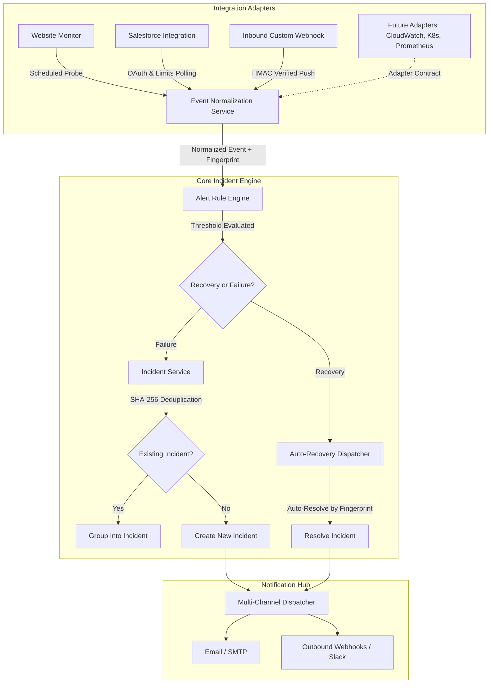

# Emblemix — Integration Architecture & Extension Guide

## 1. Universal Integration Architecture

Emblemix is engineered around a **pluggable adapter pattern** coupled with a centralized **Event Normalization and Incident Engine**.

External monitoring systems, SaaS services, and webhook clients feed into dedicated adapters. The adapters normalize heterogeneous telemetry into standard `Event` records with deterministic deduplication fingerprints. The core incident engine then evaluates alert rules and manages incident lifecycles without any coupling to the underlying technology stack.



---

## 2. Pluggable Integration Contract

Every integration in Emblemix must conform to the following contract:

1. **System Registration**:
   - Monitored entities are represented as a `ConnectedSystem` record (`WEBSITE`, `SALESFORCE`, `WEBHOOK`, or future enum values).
   - Multi-tenant isolation: `organization_id` strictly scopes all systems and credentials.

2. **Credential Storage Security**:
   - Secrets, access tokens, and refresh tokens are encrypted at rest using **AES-256-GCM** via `AesEncryptionUtil`.
   - Cleartext credentials are never exposed through REST responses or application logs.

3. **Event Normalization**:
   - Adapters produce standard `Event` instances containing:
     - `sourceType`: `EventSourceType` (`WEBSITE`, `SALESFORCE`, `WEBHOOK`, `CUSTOM`).
     - `eventType`: `EventType` (`WEBSITE_DOWN`, `SALESFORCE_API_LIMIT_CRITICAL`, `WEBHOOK_INCIDENT`, etc.).
     - `severity`: `EventSeverity` (`LOW`, `MEDIUM`, `HIGH`, `CRITICAL`).
     - `fingerprint`: Generated deterministically using `FingerprintUtil`.

---

## 3. Deterministic Deduplication Pipeline

To prevent alert storms and duplicate incidents when checks fail repeatedly, Emblemix utilizes deterministic SHA-256 fingerprint hashing:

$$\text{Fingerprint} = \text{SHA-256}(\text{OrgId} \parallel \text{SystemId} \parallel \text{SourceType} \parallel \text{BaseEventType})$$

- When an event arrives with an active fingerprint that matches an `OPEN` or `ACKNOWLEDGED` incident, the event is grouped into the existing incident rather than spawning a duplicate.
- When an event arrives with a recovery type (e.g. `WEBSITE_RECOVERED` or `WEBHOOK_RECOVERED`), the `IncidentService` automatically resolves matching open incidents for that fingerprint.

---

## 4. How to Implement a New Integration (e.g., AWS CloudWatch or Prometheus)

To introduce a new integration into Emblemix without touching existing modules:

### Step 1: Add System Type and Event Type Enums
In `com.emblemix.system.SystemType`:
```java
public enum SystemType {
    WEBSITE,
    SALESFORCE,
    WEBHOOK,
    AWS_CLOUDWATCH // New type
}
```

In `com.emblemix.event.EventType`:
```java
public enum EventType {
    // ... existing types
    CLOUDWATCH_ALARM_TRIGGERED,
    CLOUDWATCH_ALARM_RESOLVED
}
```

### Step 2: Create Ingestion Adapter Service
Create `com.emblemix.monitoring.cloudwatch.CloudWatchAdapterService`:
```java
@Service
public class CloudWatchAdapterService {
    private final EventIngestionService ingestionService;

    public void processAlarm(UUID orgId, ConnectedSystem system, CloudWatchAlarmPayload payload) {
        boolean isRecovery = "OK".equalsIgnoreCase(payload.getNewStateValue());
        EventType eventType = isRecovery
            ? EventType.CLOUDWATCH_ALARM_RESOLVED
            : EventType.CLOUDWATCH_ALARM_TRIGGERED;

        Event event = new Event(
            null,
            system.getOrganization(),
            system,
            EventSourceType.CUSTOM,
            eventType,
            mapSeverity(payload.getSeverity()),
            payload.getAlarmDescription(),
            payload.toJson(),
            null,
            Instant.now()
        );

        ingestionService.processNormalizedEvent(event, null, null, null);
    }
}
```

### Step 3: Register in Next.js Frontend
- Add new integration card in `src/app/(dashboard)/integrations/page.tsx`.
- Enable configuration in `src/app/(dashboard)/systems/page.tsx`.

The core incident engine, rule evaluator, notification dispatcher, and analytics automatically handle the new integration seamlessly.
