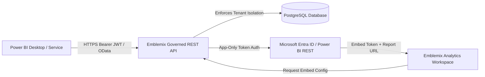

# Governed Power BI Integration & Reporting Guide

## 1. Overview & Architecture

Emblemix provides enterprise-grade integration with **Microsoft Power BI** for executives, site reliability leadership, and business stakeholders.

To prevent reporting discrepancies, Emblemix enforces a **governed analytics layer**:
- All metric definitions (MTTA, MTTR, Availability %, SLA achievement %) are computed strictly by the Emblemix backend.
- Reports consume stable REST / OData export endpoints.
- Client applications can either query governed endpoints or embed live Power BI reports securely using server-side Entra ID Service Principals.



---

## 2. Microsoft Entra ID App Registration & Permissions

To configure Power BI Embedded reporting in Emblemix:

1. **Register Entra ID Application**:
   - Navigate to **Azure Portal** > **Microsoft Entra ID** > **App registrations** > **New registration**.
   - Name: `Emblemix-PowerBI-Connector`.
   - Supported Account Types: *Accounts in this organizational directory only (Single tenant)*.
2. **Configure Power BI Service Principal API Permissions**:
   - In App Registration, navigate to **API permissions** > **Add a permission** > **Power BI Service**.
   - Add Application Permissions:
     - `Report.Read.All`
     - `Dataset.Read.All`
     - `Workspace.Read.All`
   - Click **Grant admin consent**.
3. **Enable Service Principal in Power BI Admin Portal**:
   - Log into `app.powerbi.com` as Fabric/Power BI Admin.
   - Go to **Tenant settings** > **Developer settings** > **Allow service principals to use Power BI APIs**.
   - Enable for specific security group containing the App Service Principal.
4. **Assign Workspace Access**:
   - In Power BI Service, open the target Workspace containing Emblemix reports.
   - Click **Manage access** and add the Entra App Service Principal as **Viewer** or **Contributor**.

---

## 3. Server-Side Embedded Token Generation

The frontend **never** exposes Azure Client Secrets or calls Microsoft OAuth directly. The Emblemix backend acts as a secure reverse proxy and token broker:

### Backend Configuration (`application.yml` or Environment Variables)

```yaml
emblemix:
  powerbi:
    tenant-id: ${POWERBI_TENANT_ID:3fa85f64-5717-4562-b3fc-2c963f66afa6}
    client-id: ${POWERBI_CLIENT_ID:11111111-2222-3333-4444-555555555555}
    client-secret: ${POWERBI_CLIENT_SECRET:your-azure-client-secret}
    workspace-id: ${POWERBI_WORKSPACE_ID:aaaa-bbbb-cccc-dddd}
```

### Embed Endpoint Contract (`GET /api/v1/analytics/powerbi/embed-config/{reportId}`)

Returns the embed configuration consumed by `powerbi-client` SDK:

```json
{
  "reportId": "rep-incident-kpi-01",
  "reportName": "Executive Incident & SLA Performance",
  "embedUrl": "https://app.powerbi.com/reportEmbed?reportId=rep-incident-kpi-01&groupId=aaaa-bbbb-cccc-dddd",
  "embedToken": "H4sIAAAAAAAEAC2...[Server-Signed JWT]...",
  "expiration": "2026-11-24T18:00:00Z"
}
```

---

## 4. Multi-Tenant Row-Level Security (RLS)

Multi-tenant security is strictly enforced at two levels:

1. **Power BI Direct Query / REST / OData**:
   - The export endpoints (`/api/v1/analytics/governed/incidents`, `/api/v1/analytics/governed/monitoring`) require organization-scoped JWTs.
   - The query automatically filters by `WHERE organization_id = :currentOrgId`.
2. **Power BI Embedded Dynamic RLS**:
   - When generating an Embed Token for a report backed by an import dataset, the backend injects the `EffectiveIdentity`:
     ```json
     {
       "username": "user@example.com",
       "roles": ["OrganizationTenantFilter"],
       "customData": "098801ca-3546-4a7c-98e6-fdce13fc3726"
     }
     ```
   - In DAX:
     ```dax
     [organization_id] = CUSTOMDATA()
     ```

---

## 5. Connecting Power BI Desktop to Governed Endpoints

Data analysts and BI engineers can ingest Emblemix datasets directly into Power BI Desktop:

### 5.1 OData / Web REST Feed
1. Open **Power BI Desktop**.
2. Click **Get Data** > **Web** (or **OData Feed**).
3. URL: `https://app.emblemix.com/api/v1/analytics/governed/incidents`
4. HTTP Request Header:
   - Header Key: `Authorization`
   - Header Value: `Bearer <YOUR_EMBLEMIX_API_KEY_OR_JWT>`
5. Click **OK** to load normalized incidents with stable column schemas (`incident_id`, `system_name`, `team_name`, `mtta_minutes`, `mttr_minutes`, `resolved`).

### 5.2 Available Governed Endpoints

- `GET /api/v1/analytics/kpis`: Consolidated uptime, availability %, MTTA, MTTR, and SLA compliance.
- `GET /api/v1/analytics/teams/performance`: Per-team MTTA, MTTR, active incident counts, and SLA compliance.
- `GET /api/v1/analytics/governed/incidents`: Tabular incident records with MTTA and MTTR durations.
- `GET /api/v1/analytics/governed/monitoring`: Tabular monitoring check history with latency and status.
- `GET /api/v1/analytics/powerbi/catalog`: Discovered Power BI reports for the current organization.
